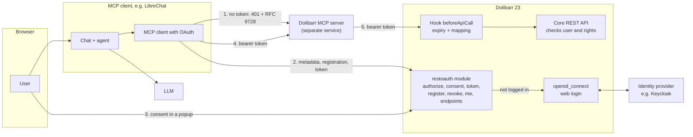

# Architecture: AI access to Dolibarr with restoauth

## Goal

Users sign in once (with Dolibarr's own login, or through an identity provider such as Keycloak),
and the AI assistant works in Dolibarr with exactly that user's rights, without anybody copying an
API key.

For iTop, the altioo-oauth-server extension does this: it is an OAuth server inside iTop and issues
tokens that iTop's REST API accepts directly. Dolibarr has nothing like it. Dolibarr's OAuth module
is only a client for outgoing connections (for example for sending mail), and the Keycloak login
(`openid_connect`) only covers the web interface, not the REST API.

So the [restoauth](https://github.com/storkakos/dolibarr-restoauth) module makes Dolibarr an OAuth
authorization server that issues tokens the REST API accepts, and this MCP server forwards them.
**The target version is Dolibarr 23; Dolibarr's core code is not changed.**

Terms (MCP server, MCP client, authorization server, identity provider, connect right, rights map)
are defined in the [glossary](../GLOSSARY.md).

## Components and flow

restoauth lives in Dolibarr and issues the tokens; the MCP server only passes them on.

First use:

1. The MCP client calls the MCP server, gets `401` and the address of the authorization server
   (protected resource metadata, RFC 9728).
2. The MCP client reads restoauth's metadata (RFC 8414,
   `/.well-known/oauth-authorization-server/custom/restoauth`) and registers itself (RFC 7591, only
   with redirect URIs on the allowlist).
3. The browser opens `authorize.php`. restoauth checks the request **without a login** and forwards
   it, signed, to the consent page `consent.php`. If the user is not logged in, Dolibarr sends them
   to the identity provider (`openid_connect`) and back to the consent page afterwards.
4. On the consent page, the user confirms what the client may do (a plain-language list of their
   rights). Only users with the connect right (or admins) get an Allow button.
5. restoauth issues a code (2 minutes by default, single use); the client exchanges it with PKCE
   (S256) for an access token (1 hour by default) and a refresh token.
6. The client sends the access token as a bearer token to the MCP server, which passes it on to the
   REST API. Dolibarr checks user and rights as for an API key.

## Dolibarr 23 quirks

Found in Dolibarr 23.0.3's `htdocs/api/index.php`, `api/class/api_access.class.php`,
`user/api_token/card.php`, `core/login/functions_openid_connect.php`,
`core/modules/openid_connect/callback.php` and `core/tpl/login.tpl.php`. The docs must keep these.

| Finding | Consequence |
| --- | --- |
| **`API_IN_TOKEN_TABLE=1` is broken in 23.0.3.** The query in `api_access.class.php` selects `rowid as token_rowid` without a table prefix; MariaDB reports "Column 'rowid' is ambiguous", and every API request ends with `503`. Dolibarr 24 fixes it (`oat.rowid`). | The core token table stays off. restoauth maps its tokens with a hook (next row). Side benefit: existing `DOLAPIKEY` integrations (e.g. n8n) stay valid, with no global switch. |
| **The `beforeApiCall` hook runs before the core checks the key** (in `api/index.php`, before `$api->r->handle()`). | The hook checks the restoauth token (expiry, revocation) and, for this one request, replaces it with the user's internal API key (`llx_user.api_key`). The core then checks status, validity and rights as always. Nobody gets to see the internal key. |
| The core authentication does not check `expire_at`. | The hook refuses expired tokens with `401` and deletes them; a cron job cleans up as well. No core patch is needed. |
| The Keycloak login reads `state` with `GETPOST()`, from the URL first. If the client's OAuth request (with its own `state`) is in the URL of the page that triggers the login, the login fails. | `authorize.php` (no login) packs the request, signed (HMAC with the instance ID, 15 minutes by default), into one parameter `req` and redirects to `consent.php` (with login). |
| After the Keycloak login, `callback.php` posts back to the page stored in the cookie `DOL_rollback_url_*` (set by the login page). | The browser returns to the consent page after the Keycloak login. Limitation: the cookie is only set when it is empty (1 hour). |
| `user/api_token/card.php` stores new tokens in the column `token`, but the API looks in `tokenstring`. | restoauth writes `tokenstring` (encrypted with `dolEncrypt`, with the same fixed seed as the core). |
| **The Swagger explorer does not run the hook** and shows only public paths for OAuth tokens. | restoauth has its own endpoint `GET /restoauth/endpoints`, which runs the same search over all active API classes. |
| `GET /thirdparties/{id}/outstandinginvoices` only checks `societe.lire`, but shows outstanding invoice amounts. | The MCP server is deliberately stricter: it also requires `facture.lire` (an exception in its rights rules), and the same for the `getinvoicesqualifiedfor...` paths. |
| **Dolibarr 23 does not create Keycloak users automatically** (`autocreateuser` only works from 24). | Every user must exist in Dolibarr, with login = Keycloak `preferred_username`. |
| A user can have several tokens; a disabled user is refused. | Several clients in parallel; offboarding in Dolibarr also blocks all connections. |

## restoauth

Lives in `htdocs/custom/restoauth`, changes no core code, PHP like any Dolibarr module. Details:
[restoauth README](https://github.com/storkakos/dolibarr-restoauth#readme).

| Endpoint | Purpose |
| --- | --- |
| `metadata.php` (RFC 8414) | Addresses and methods; at `/.well-known/oauth-authorization-server/custom/restoauth` through a rewrite rule |
| `authorize.php` | Checks client, redirect URI, PKCE (S256 required) and resource; no login; forwards signed to `consent.php` |
| `consent.php` | Behind the normal Dolibarr login (also Keycloak); shows the rights, issues the code |
| `token.php` | Code or refresh token for a new pair; refresh tokens are replaced on every use |
| `register.php` (RFC 7591) | Creates a client, only for redirect URIs on the allowlist (loopback optional) |
| `revoke.php` (RFC 7009) | Ends the whole connection (access and refresh tokens) |
| REST `GET /restoauth/me` | User, active modules, rights (fresh from the database), token expiry, rights rules |
| REST `GET /restoauth/endpoints` | Readable paths of all active API classes, including those of other modules |

**Tokens.** The access token is stored encrypted in `llx_oauth_token`
(`service = 'dolibarr_rest_api'`, `state = 'restoauth:<connection>'`, `expire_at`). From Dolibarr 24
with `API_IN_TOKEN_TABLE=1` the core could read it directly; on 23 the hook maps it. Only Dolibarr 23
is tested and supported.

**Own tables.** Clients, authorization codes (single use) and refresh tokens (with a connection ID).
Codes, refresh tokens and client secrets are stored only as SHA-256.

**Reuse detection.** If an old refresh token is presented again, restoauth revokes the whole
connection.

**User interface.** Setup page (lifetimes, redirect allowlist, resources, registered clients), tab
**Connected applications** on the user card with "end connection", cron job for expired tokens.
Disabling a user ends all of that user's connections.

**The connect right** "Connect applications via OAuth". Only users with this right (or admins) can
authorize a client, comparable to `personal_tokens_allowed_profiles` in iTop.

**No scopes in the core.** A Dolibarr token always carries all rights of its user. Read-only access is
enforced by the MCP server.

## Rights in the MCP server

- **Rights:** `GET /restoauth/me` returns the rights as `module.right` or `module.object.right` (e.g.
  `facture.lire`, `societe.client.voir`). The MCP server keeps them in memory only, for at most
  `MCP_RIGHTS_CACHE_SECONDS` (default 30) and never longer than the token is valid.
- **Tool filter:** tools without a matching right are not offered to the agent (a user without
  `facture.lire` sees no invoice tool). This is not the security boundary: Dolibarr checks every call
  itself, and the MCP server refuses a call without the right before it reaches Dolibarr.
- **Default rule:** `GET` needs `lire`/`read`, and the module is the first path segment. Exceptions
  come from restoauth's `rights_map.json` (e.g. `contacts` → `societe.contact.lire`, `tickets` →
  `ticket.read`, `categories` → `categorie.lire`, paths that need several rights), plus the MCP
  server's own stricter rules.
- **Read-only:** every tool sends only `GET`. Generic: `list_api_endpoints` and `api_get` (only
  readable paths that `restoauth/endpoints` lists, at most `MCP_MAX_ROWS` rows).
- **`societe.client.voir`:** decides whether a user sees all third parties or only their own;
  Dolibarr filters this itself.

## Compared with altioo-oauth-server

| Aspect | iTop with altioo-oauth-server | Dolibarr with restoauth |
| --- | --- | --- |
| Protocol | OAuth 2.1, authorization code with PKCE, RFC 8414, 9728, 7591, 7009 | the same, plus `iss` in the authorization response (RFC 9207) |
| Access token | iTop personal token, 1 hour | row in `llx_oauth_token`, 1 hour by default, mapped by the hook to the internal API key |
| Expiry | checked by iTop | checked by restoauth's hook |
| Refresh token | rotating | rotating, with reuse detection |
| Identity provider login | hybridauth extension | `openid_connect` in the core |
| Prerequisite | `authent-token`, `allow_rest_services_via_tokens` | API REST enabled; `API_IN_TOKEN_TABLE` stays **off** (23.0.3) |
| Rights of the tokens | the user's profiles | all rights of the user, no scopes |
| Who may connect | `required_profiles` of the resource | the connect right |
| Licence | AGPL-3.0-or-later | GPL-3.0-or-later, own code, nothing copied from altioo |

## Security notes and risks

- **Internal API key.** For every connected user, restoauth creates an API key in `llx_user.api_key`
  if there is none. It never leaves Dolibarr, but it does not expire. Whoever has the database and
  `conf.php` can decrypt it. With Dolibarr 24 and `API_IN_TOKEN_TABLE=1` it would no longer be needed.
- **Encrypted, not hashed.** Access tokens are stored with `dolEncrypt` (like the core does). Short
  lifetimes and revocation limit the damage.
- **Full rights.** There are no scopes. The MCP server offers only reading tools.
- **Prompt injection.** Text from Dolibarr (notes, descriptions) can contain instructions. The server
  instructions tell the model that record text is data, and the agent can never do more than read
  what the user may read.
- **Offboarding.** Disabling a user in Keycloak leaves the Dolibarr user active. Disable the user in
  Dolibarr: that ends all their connections, and the REST API refuses their tokens.
- **Dolibarr version.** Dolibarr 23.0.3 has published authorization flaws in the REST API that are
  fixed only in 24.0.2 (among them, non-admins can set administrator passwords). The MCP server
  therefore only sends `GET`. Write tools need a review of these flaws first.

## Possible next steps

- When moving to Dolibarr 24.0.2 or later: test `API_IN_TOKEN_TABLE=1`, which makes the internal API
  key unnecessary and includes the REST API security fixes.
- Write tools only with an allowlist, a preview and an explicit confirmation by the user.
- Check Dolibarr 25 once it is released.
