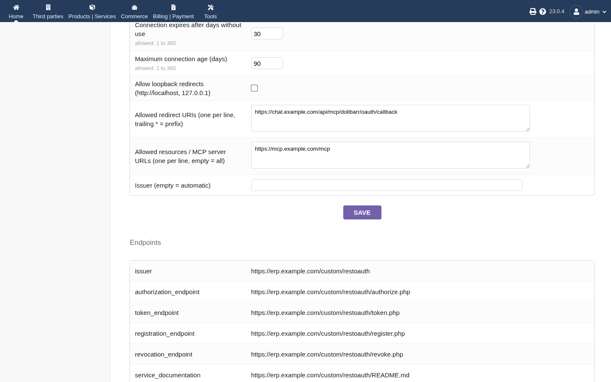
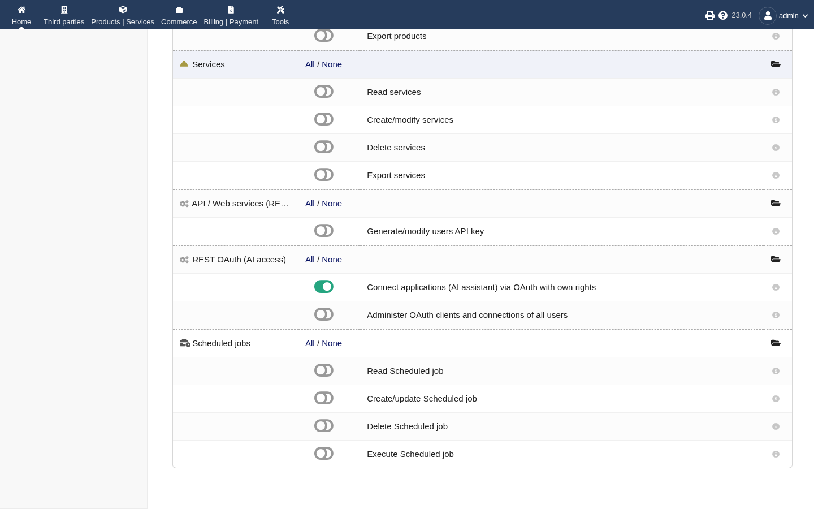
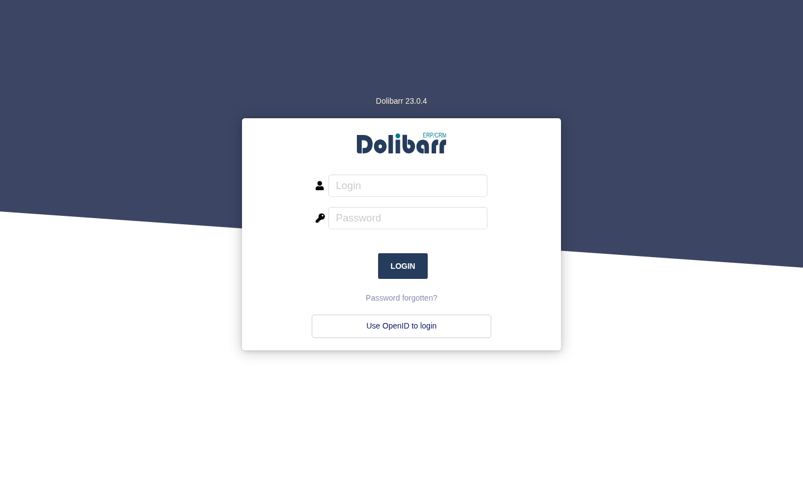
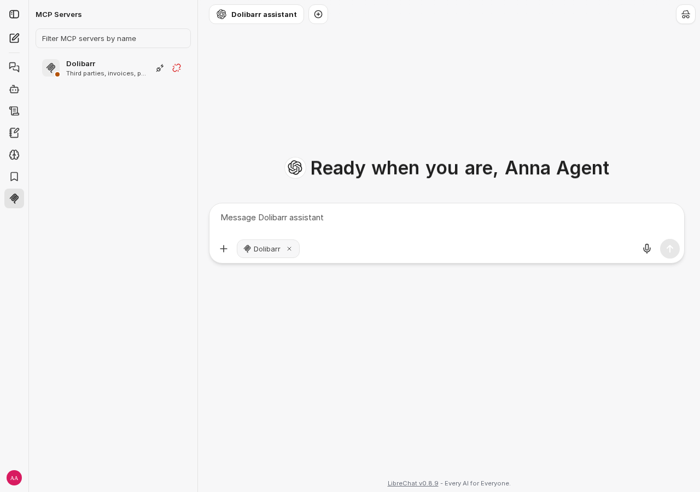
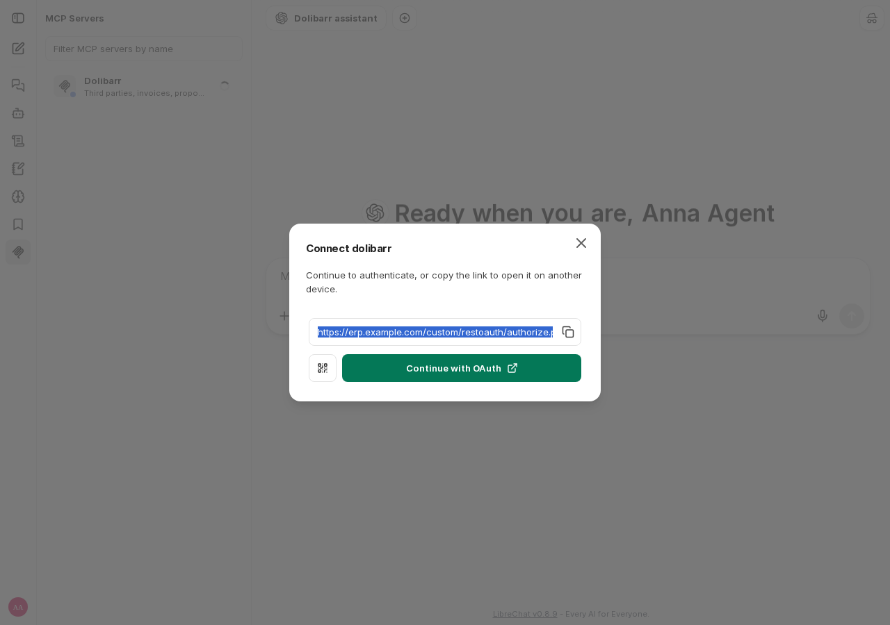
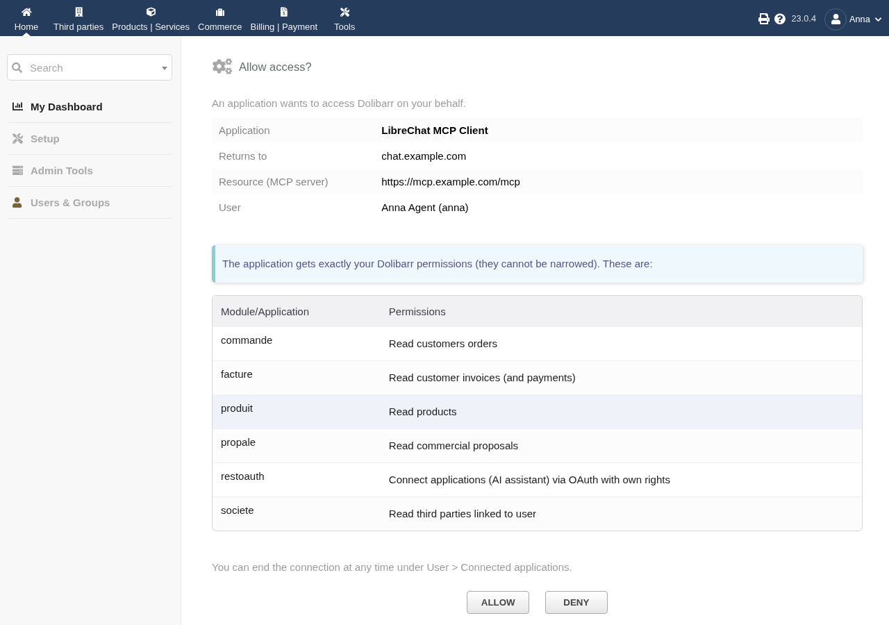
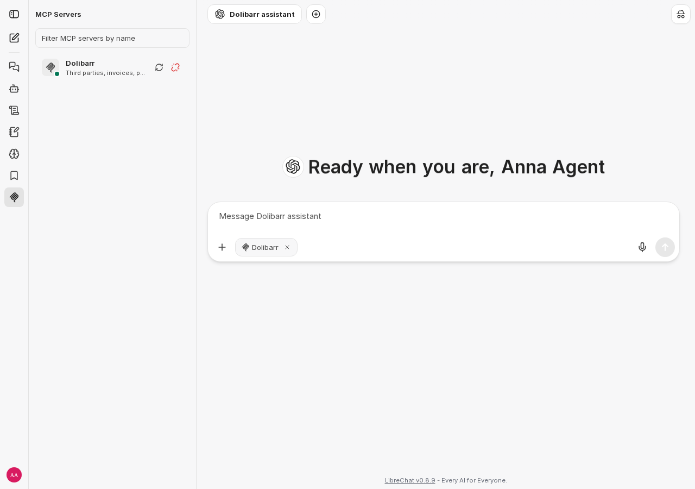
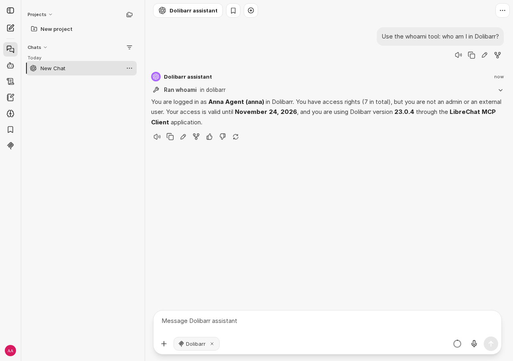
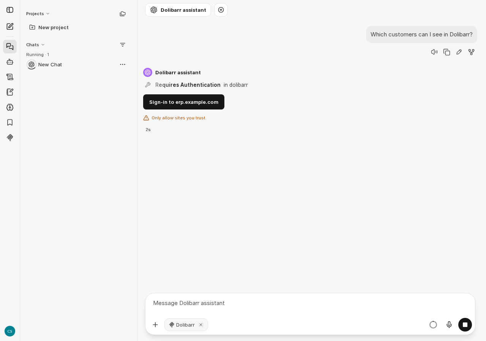
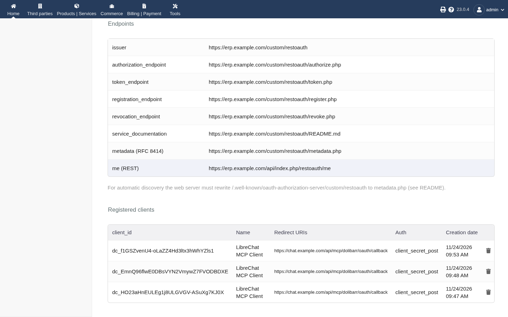

# Quick start for administrators

This guide takes you from an existing Dolibarr 23 to a working **Dolibarr assistant**: users chat
in LibreChat, and the assistant reads third parties, invoices, proposals, orders and products from
Dolibarr with each user's own Dolibarr rights. It walks through the whole setup in order, with
screenshots, and links to the detailed manuals for every step:

- [README](../README.md): the MCP server itself (install, configuration, reverse proxy, audit log)
- [Dolibarr prerequisites](setup/dolibarr-prerequisites.md): what Dolibarr needs (required)
- [restoauth README](https://github.com/storkakos/dolibarr-restoauth#readme): every setting of the
  module that makes Dolibarr the authorization server
- [Example setup: Keycloak and LibreChat](setup/example-keycloak-librechat.md): login and chat
  client (optional, one possible setup)

When this guide and a manual differ, the manual is right. The screenshots come from the
[test stack](../test-stack/README.md) (Dolibarr 23.0.4, restoauth 0.2.2, Keycloak 26.8.2,
LibreChat v0.8.9). Your screens may look slightly different in other versions.

> **Try it first without risk.** The test stack runs this whole setup on one Docker host, with
> test users and sample data, in about five minutes. It is a good way to see every screen below
> before you touch your production Dolibarr.

## Contents

1. [How it fits together](#1-how-it-fits-together)
2. [Before you start](#2-before-you-start)
3. [Prepare Dolibarr](#3-prepare-dolibarr)
4. [Start the MCP server](#4-start-the-mcp-server)
5. [Check the chain with curl](#5-check-the-chain-with-curl)
6. [Optional: log into Dolibarr with Keycloak](#6-optional-log-into-dolibarr-with-keycloak)
7. [Connect LibreChat](#7-connect-librechat)
8. [First connection and first question](#8-first-connection-and-first-question)
9. [Day-to-day operation](#9-day-to-day-operation)
10. [When something goes wrong](#10-when-something-goes-wrong)

## 1. How it fits together

```
 User ──► LibreChat (MCP client) ──► MCP server ──► Dolibarr REST API
                │                     (this repo)          ▲
                │  OAuth: login + consent                  │ same token
                └──────────────► Dolibarr + restoauth ─────┘
                                 (authorization server)
```

- **Dolibarr issues the token.** With the restoauth module, Dolibarr logs the user in, asks for
  consent and issues an access token for the user's own Dolibarr account.
- **The MCP server only forwards it.** Every tool call goes to Dolibarr's REST API with the
  caller's token, so each user sees exactly what Dolibarr allows them to see. The server stores no
  secrets, issues no tokens and can only read.
- **Keycloak is optional.** It only logs users into Dolibarr and LibreChat. It never issues tokens
  for the MCP server.

## 2. Before you start

You need:

| What | Requirement |
|---|---|
| Dolibarr | **23**, with HTTPS and Dolibarr's scheduled jobs running |
| Docker host | Docker with Compose, `git`, internet access while building |
| Reverse proxy | Terminates TLS for the MCP server's public host name |
| MCP client | LibreChat in this guide; any MCP client with OAuth and dynamic client registration works |
| Web server access | One rewrite rule in Dolibarr's Apache or nginx configuration |

Decide your host names first. This guide uses the example names below; replace them everywhere.

| Example | What it is |
|---|---|
| `https://erp.example.com` | Dolibarr (`DOLIBARR_URL`) |
| `https://erp.example.com/custom/restoauth` | restoauth's issuer (`DOLIBARR_OAUTH_ISSUER`) |
| `https://mcp.example.com/mcp` | Public URL of the MCP server (`MCP_RESOURCE_URL`) |
| `https://chat.example.com` | LibreChat |
| `https://sso.example.com` | Keycloak (optional) |

> **The one value that must match exactly:** `https://mcp.example.com/mcp` appears in three places
> (the MCP server's `.env`, restoauth's **Allowed resources** and `librechat.yaml`). It must be
> identical in all three: same scheme, host, port and path. A mismatch is the most common setup
> error and shows up as `invalid_target` ("Resource is not allowed") from restoauth.

## 3. Prepare Dolibarr

Full details: [Dolibarr prerequisites](setup/dolibarr-prerequisites.md).

### 3.1 Install restoauth

Back up the Dolibarr database first. Download `module_restoauth-X.Y.Z.zip` from the
[restoauth releases](https://github.com/storkakos/dolibarr-restoauth/releases). In Dolibarr, go to
**Setup** → **Modules/Applications** → tab **Deploy/install external app/module**, upload the ZIP
and install it. Dolibarr unpacks it to `htdocs/custom/restoauth`.

### 3.2 Enable the modules

In **Setup** → **Modules/Applications**, enable **API REST** and **REST OAuth (AI access)**. Leave
the constant `API_IN_TOKEN_TABLE` off: it is broken in Dolibarr 23.0.3, and restoauth maps its
tokens through a hook instead.

### 3.3 The restoauth setup page

Open the setup page of **REST OAuth (AI access)** (the gear icon in the module list) and fill in
the two allowlists:

| Field | Value |
|---|---|
| Allowed redirect URIs | `https://chat.example.com/api/mcp/dolibarr/oauth/callback` (LibreChat's callback) |
| Allowed resources / MCP server URLs | `https://mcp.example.com/mcp` (exactly `MCP_RESOURCE_URL`) |
| Allow loopback redirects | off |
| Issuer | empty |



Keep the lifetimes at their defaults (access token 3600 seconds, connection 30 days without use
and 90 days at most).

Below the settings, the page lists the **Endpoints**. The **issuer** shown there is the value for
`DOLIBARR_OAUTH_ISSUER` in the MCP server's `.env`. What every field means:
[restoauth README → Configure Dolibarr](https://github.com/storkakos/dolibarr-restoauth#configure-dolibarr).

### 3.4 Grant the connect right

Give the users or groups who should use the assistant the right **Connect applications (AI
assistant) via OAuth with own rights** (module REST OAuth), on their **Permissions** tab. Without
it, the consent page offers only **Deny**. Administrators may always connect, but an administrator's
token reads everything: give administrators a second, non-admin account for the assistant.



The assistant reads with all rights of the user, Dolibarr has no scopes. Check what the users you
grant the right to may read: see
[What the assistant can read](setup/dolibarr-prerequisites.md#what-the-assistant-can-read).

### 3.5 Web server rewrite

MCP clients look for restoauth's metadata at the site root. Add this to the Dolibarr Apache vhost
(for nginx and for Dolibarr below a path prefix see
[restoauth README → Rewrite rules for discovery](https://github.com/storkakos/dolibarr-restoauth#rewrite-rules-for-discovery)):

```apache
RewriteEngine On
RewriteRule ^/?\.well-known/(oauth-authorization-server|openid-configuration)/custom/restoauth/?$ /custom/restoauth/metadata.php [L]
RewriteRule ^/?custom/restoauth/\.well-known/(oauth-authorization-server|openid-configuration)/?$ /custom/restoauth/metadata.php [L]
```

If a reverse proxy terminates TLS in front of Dolibarr, Dolibarr must also know its public URL
(`$dolibarr_main_url_root` is `https://erp.example.com`, and the proxy passes
`X-Forwarded-Proto: https`), or the issuer and the login redirects use `http://`.

## 4. Start the MCP server

Full details: [README → Install](../README.md#install).

```sh
git clone https://github.com/storkakos/dolibarr-mcp-server.git
cd dolibarr-mcp-server
git checkout v0.1.1

cp .env.example .env
# set DOLIBARR_URL=https://erp.example.com
# set DOLIBARR_OAUTH_ISSUER=https://erp.example.com/custom/restoauth
# set MCP_RESOURCE_URL=https://mcp.example.com/mcp
${EDITOR:-vi} .env

mkdir -p logs && sudo chown 10001:10001 logs   # before the first start
docker compose up -d --build
docker compose ps                              # wait for "(healthy)"
```

Then point your reverse proxy at `127.0.0.1:8131` for the host `mcp.example.com`. It must pass the
`Host` and `Authorization` headers through unchanged. Examples for nginx and Apache:
[README → Reverse proxy](../README.md#reverse-proxy-tls).

## 5. Check the chain with curl

Run these against the **public** URLs. Each one builds on the one before.

```sh
# 1. restoauth's metadata at the site root: JSON with "issuer": "https://erp.example.com/custom/restoauth"
curl -s https://erp.example.com/.well-known/oauth-authorization-server/custom/restoauth

# 2. restoauth's REST extension without a token: HTTP 401 (404 or 501: API REST or restoauth is off)
curl -si https://erp.example.com/api/index.php/restoauth/me | head -n 1

# 3. The MCP server without a token: HTTP 401 with a www-authenticate header pointing to its metadata
curl -si -X POST https://mcp.example.com/mcp -H 'Content-Type: application/json' \
  -H 'Accept: application/json, text/event-stream' \
  -d '{"jsonrpc":"2.0","id":1,"method":"initialize","params":{}}' | head -n 20

# 4. The MCP server's metadata: "resource" is your MCP_RESOURCE_URL,
#    "authorization_servers" is the issuer from check 1
curl -s https://mcp.example.com/.well-known/oauth-protected-resource/mcp
```

Check 5 compares the resource URL in all three places. If a check fails, the table under it in
[the check list](setup/dolibarr-prerequisites.md#check-list) names the cause.

## 6. Optional: log into Dolibarr with Keycloak

Skip this section if users log into Dolibarr with Dolibarr's own login form. Full details:
[Example setup → Keycloak](setup/example-keycloak-librechat.md#keycloak-client-for-dolibarr).

### 6.1 A Keycloak client for Dolibarr

In the Keycloak admin console, realm `example`: **Clients** → **Create client**, client ID
`dolibarr`. Turn **Client authentication** on, allow the **Standard flow** only, leave **Require
PKCE** off (Dolibarr 23's `openid_connect` login does not send PKCE), and set **Valid redirect
URIs** to exactly `https://erp.example.com/core/modules/openid_connect/callback.php`. Copy the
**Client Secret** from the **Credentials** tab. All values:
[the example setup](setup/example-keycloak-librechat.md#keycloak-client-for-dolibarr).

Make sure users cannot choose or change their Keycloak username (**Edit username** and **User
registration** off, the defaults): Dolibarr finds the user by it.

### 6.2 Tell Dolibarr about Keycloak

In `conf/conf.php`, add `openid_connect` to the authentication modes and keep `dolibarr`, so that
local accounts still work:

```php
$dolibarr_main_authentication = 'openid_connect,dolibarr';
```

Then, as administrator, **Setup** → **Security** → tab **OpenID authentication parameters**: switch
on the OpenID Connect mode and fill in the login claim `preferred_username`, client ID, client
secret and the Keycloak URLs from
[the example setup](setup/example-keycloak-librechat.md#setup--security--openid-authentication-parameters).

### 6.3 Dolibarr users

Dolibarr 23 does **not** create users on their first Keycloak login. For every user, create a
Dolibarr user whose **login is exactly their Keycloak username**, with the read rights they need and
the connect right (step 3.4). Dolibarr's login page then offers **Use OpenID to login**:



## 7. Connect LibreChat

Full details: [Example setup → LibreChat](setup/example-keycloak-librechat.md#librechat).

Add to `librechat.yaml` (keep everything else in the file) and restart LibreChat:

```yaml
mcpServers:
  dolibarr:
    type: streamable-http
    url: https://mcp.example.com/mcp        # exactly MCP_RESOURCE_URL
    title: Dolibarr
    description: Third parties, invoices, proposals, orders and products from Dolibarr, with your own Dolibarr rights
    requiresOAuth: true                     # no "oauth:" block: LibreChat finds restoauth by itself

mcpSettings:
  allowedDomains:
    - "https://mcp.example.com"
    - "https://erp.example.com"             # both hosts, or OAuth fails on private IPs

modelSpecs:
  list:
    - name: dolibarr-assistant
      label: Dolibarr assistant
      description: Answers questions about Dolibarr with your own Dolibarr rights
      preset:
        endpoint: <your endpoint>           # a model that supports tool calls
        model: <your model>
      mcpServers:
        - dolibarr
```

The server name `dolibarr` is part of LibreChat's callback
(`https://chat.example.com/api/mcp/dolibarr/oauth/callback`), which must be in restoauth's
**Allowed redirect URIs** (step 3.3). To start every new chat with the Dolibarr assistant, see
[Dolibarr assistant preselected](setup/example-keycloak-librechat.md#librechatyaml-the-dolibarr-mcp-server).

For logging into LibreChat with Keycloak (a second Keycloak client `librechat` and a few `.env`
keys), follow [the example setup](setup/example-keycloak-librechat.md#keycloak-client-for-librechat).

## 8. First connection and first question

Do this once yourself as a test user with the connect right, in a private browser window. Each user
goes through it once; after that, LibreChat renews the token in the background.

**1. Open the MCP servers.** In LibreChat, click the **MCP Settings** icon in the left bar.
**Dolibarr** has an orange dot: not connected yet. Click the **Connect** icon (the plug) next to it.



**2. Start the OAuth flow.** LibreChat shows the restoauth link. Click **Continue with OAuth**. A
new tab opens with Dolibarr's login page; log in (with Keycloak: **Use OpenID to login**).



**3. Give consent in Dolibarr.** restoauth names the application (**LibreChat MCP Client**), where
it sends you back (`chat.example.com`), the resource (`https://mcp.example.com/mcp`) and the Dolibarr
user, and lists that user's rights. Click **Allow**. The tab closes by itself.



If restoauth answers "Resource is not allowed" or the page offers only **Deny**, see
[section 10](#10-when-something-goes-wrong).

**4. Connected.** The dot next to **Dolibarr** turns green.



**5. Ask who you are.** Start a new chat with the **Dolibarr assistant** and ask:

> Use the whoami tool: who am I in Dolibarr?

The assistant runs the `whoami` tool and names the Dolibarr user behind your account:



Repeat with a second user: the answer must name that user. From now on the assistant reads exactly
what this Dolibarr user may read, and nothing more.

If a user asks a question before connecting, LibreChat shows a sign-in button right in the chat,
which starts the same flow:



## 9. Day-to-day operation

**Your users.** Hand them the [user guide](user-guide.md): logging in, connecting once, asking good
questions, disconnecting. Replace the example addresses in it with yours.

**Who is connected.** Every Dolibarr user sees their own connections on their user card, tab
**Connected applications**, and can end them there (see the
[user guide](user-guide.md#5-your-connection)). restoauth's setup page lists the **Registered
clients**: LibreChat registers one client of its own per user who connected.



**Ending access.**

- A user disconnects in LibreChat with **Revoke** (next to **Connect**, see step 8.1) or on their
  user card in Dolibarr.
- Disabling the Dolibarr user ends all of that user's connections at once; the MCP server refuses
  the token after at most `MCP_RIGHTS_CACHE_SECONDS` (30 seconds by default).
- Every connection ends after 90 days, or after 30 days without use, and the user consents again.

**Audit log.** Every tool call writes one JSON line to `logs/mcp-dolibarr-audit.log` on the Docker
host, with the Dolibarr user, the tool and its arguments, never the token. Rotate it with logrotate
(`copytruncate`). Details: [README → Audit log](../README.md#audit-log).

**Updates.** `git fetch --tags && git checkout vX.Y.Z && docker compose up -d --build`. The server
keeps no state; rolling back is the same with the previous tag. restoauth is updated separately,
inside Dolibarr, from its release ZIP. Details:
[README → Update and rollback](../README.md#update-and-rollback).

## 10. When something goes wrong

| Symptom | Most likely cause | Details |
|---|---|---|
| Container restarts in a loop | `./logs` not owned by UID 10001, or a value missing in `.env` | [README → Troubleshooting](../README.md#troubleshooting) |
| LibreChat cannot find the authorization server (`404` on `/.well-known/oauth-authorization-server/custom/restoauth`) | The discovery rewrite rule is missing | [Check 1](setup/dolibarr-prerequisites.md#1-the-authorization-server-metadata-answers-at-the-site-root) |
| LibreChat cannot register (`invalid_redirect_uri`, "Redirect URI not allowed") | Its callback is not in **Allowed redirect URIs** | [Check 6](setup/dolibarr-prerequisites.md#6-an-mcp-client-can-connect) |
| restoauth says **"Resource is not allowed"** (`invalid_target`) | The resource URL differs between `.env`, **Allowed resources** and `librechat.yaml` | [Check 5](setup/dolibarr-prerequisites.md#5-the-resource-url-matches-in-all-three-places) |
| LibreChat fails before any Dolibarr page, log mentions a **private IP** | `allowedDomains` lacks one of the two hosts | [Example check 6](setup/example-keycloak-librechat.md#6-connecting-the-dolibarr-server-opens-restoauths-consent-page) |
| The consent page shows no **Allow** button | The user lacks the connect right | [Step 3.4](#34-grant-the-connect-right) |
| The Keycloak login into Dolibarr fails for a new user | No Dolibarr user whose login is the Keycloak username | [Example check 3](setup/example-keycloak-librechat.md#3-a-keycloak-user-logs-into-dolibarr) |
| Consent works, but every tool call gets `401`; `docker compose logs` says `Token rejected` | Dolibarr refuses the token: `API_IN_TOKEN_TABLE` on (`HTTP 503`), user disabled, or wrong `DOLIBARR_URL` | [README → Troubleshooting](../README.md#troubleshooting) |
| Tool calls fail with **421** | The reverse proxy does not pass the public `Host` header | [README → Reverse proxy](../README.md#reverse-proxy-tls) |
| A tool is missing for a user | The user lacks the Dolibarr right for it; `my_permissions` lists the rights | [README → Tools](../README.md#tools-and-the-per-user-token-model) |
